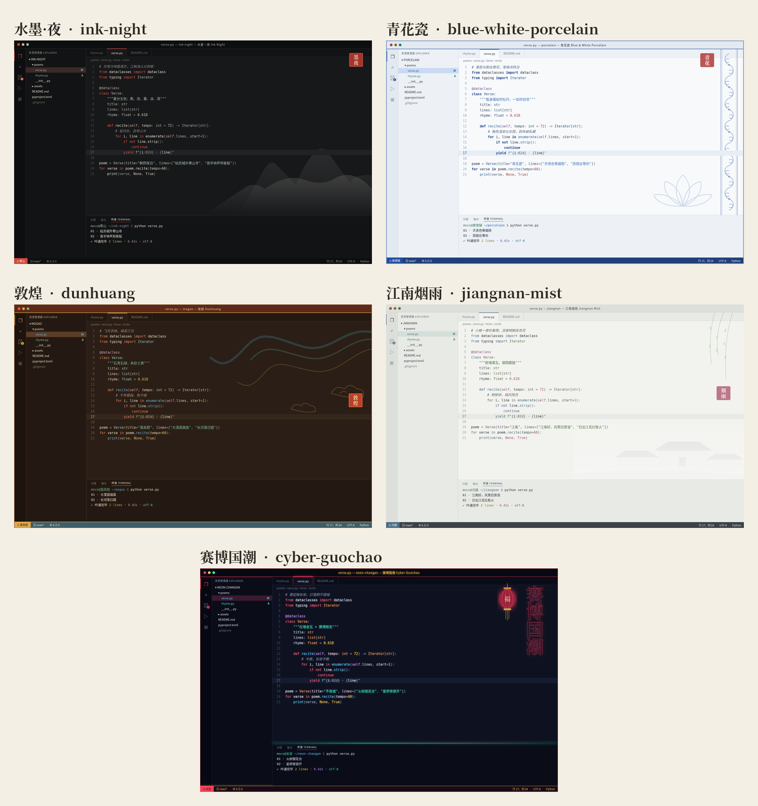
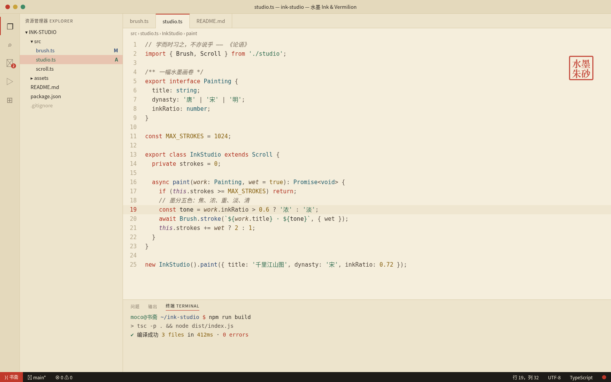
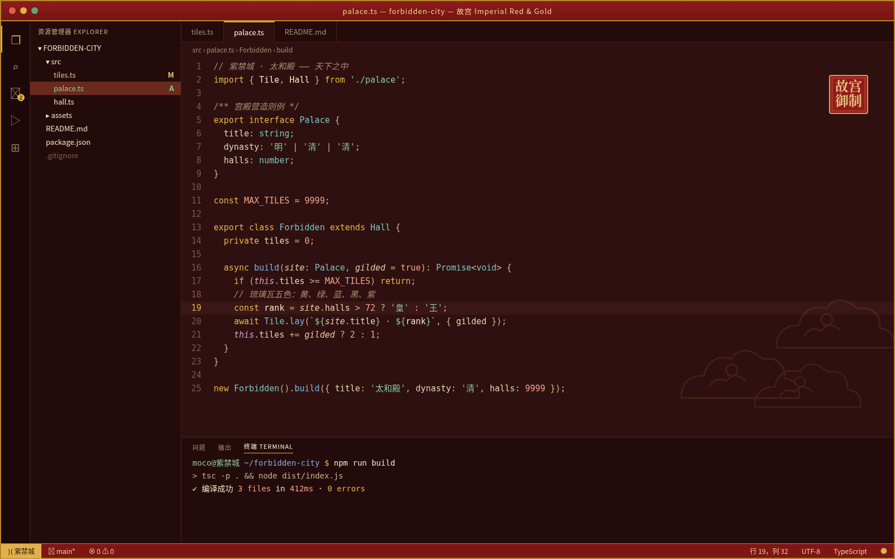
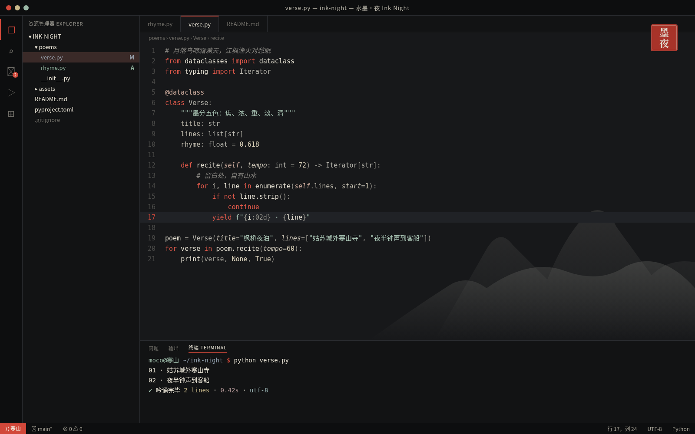
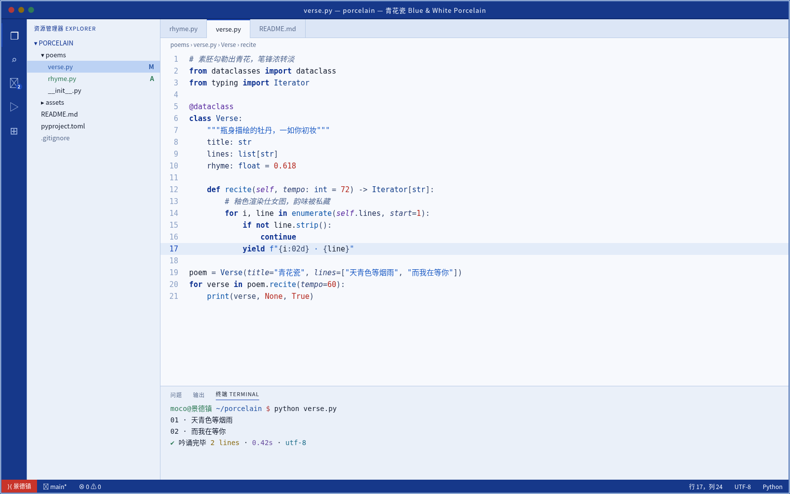
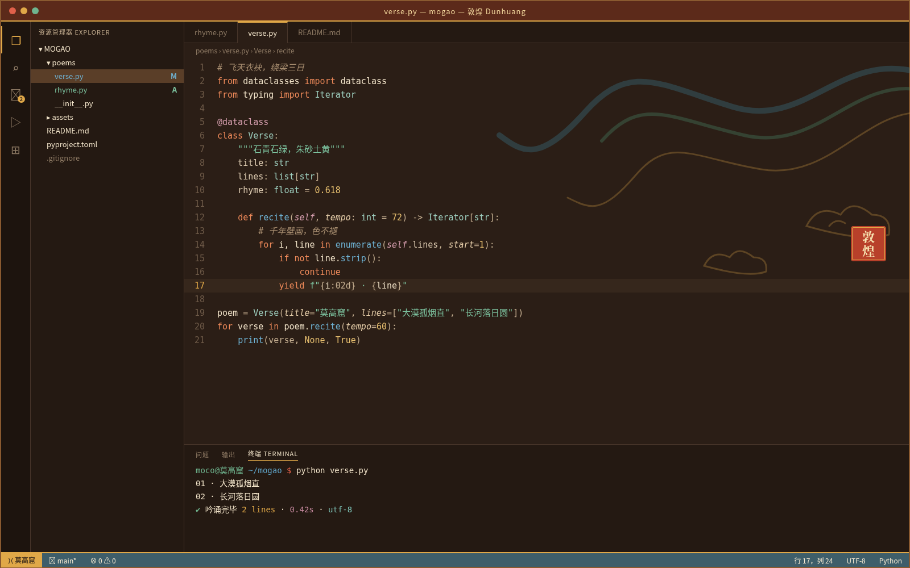
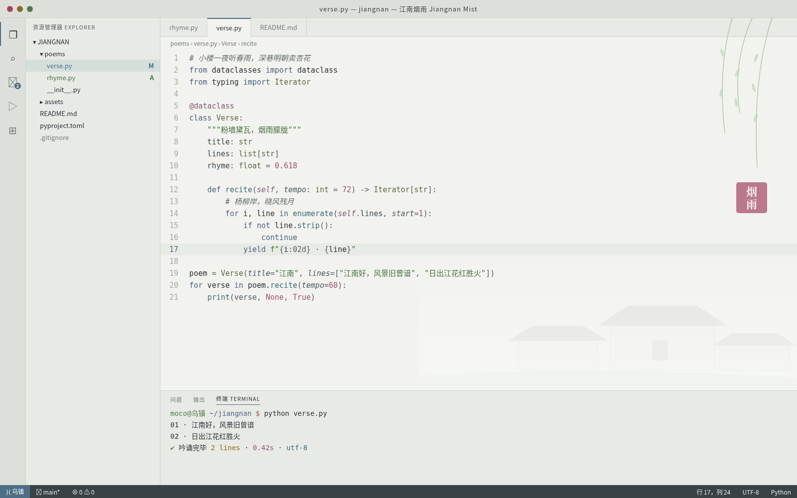
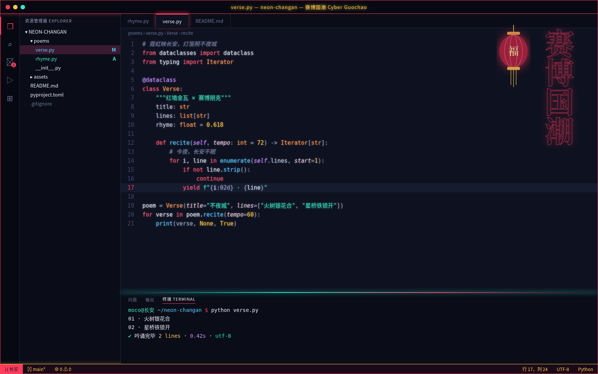
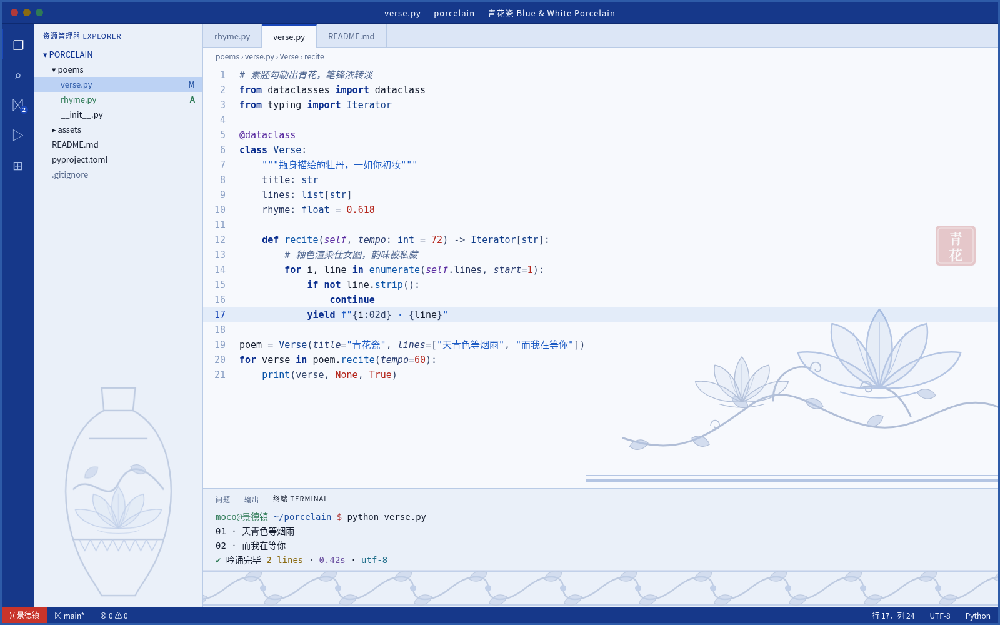

# 中国风主题合集 Chinese Style Themes for VS Code / Cursor

七套可直接安装的中国风配色，面向 VS Code 与 Cursor。每套都是独立扩展（发布者 `moco`，MIT），附带打好的 `.vsix`，下载后即可安装。主要文字对比度按 WCAG AA 校准。



## 主题一览

| 主题 | 说明 | 明暗 | 目录 | 安装包 |
| --- | --- | --- | --- | --- |
| 水墨 Ink & Vermilion | 宣纸暖白底、墨色正文、朱红关键字、玉绿字符串 | 浅色 | [themes/ink-vermilion](themes/ink-vermilion/) | [ink-vermilion-0.1.0.vsix](themes/ink-vermilion/ink-vermilion-0.1.0.vsix) |
| 故宫 Imperial Red & Gold | 宫墙红底、象牙白正文、琉璃金关键字与强调色 | 深色 | [themes/imperial-red-gold](themes/imperial-red-gold/) | [imperial-red-gold-0.1.0.vsix](themes/imperial-red-gold/imperial-red-gold-0.1.0.vsix) |
| 水墨·夜 Ink Night | 墨黑底、层层灰阶，朱砂印红只点在关键字上 | 深色 | [themes/ink-night](themes/ink-night/) | [ink-night-0.1.0.vsix](themes/ink-night/ink-night-0.1.0.vsix) |
| 青花瓷 Blue & White Porcelain | 冷白瓷底、浓淡青花蓝写代码，釉里红点缀数字 | 浅色 | [themes/blue-white-porcelain](themes/blue-white-porcelain/) | [blue-white-porcelain-0.2.0.vsix](themes/blue-white-porcelain/blue-white-porcelain-0.2.0.vsix) |
| 敦煌 Dunhuang | 赭褐土色底，石青、石绿、朱砂、土黄与金色交织 | 深色 | [themes/dunhuang](themes/dunhuang/) | [dunhuang-0.1.0.vsix](themes/dunhuang/dunhuang-0.1.0.vsix) |
| 江南烟雨 Jiangnan Mist | 粉墙黛瓦、柳绿荷粉与黛蓝，低饱和而可读 | 浅色 | [themes/jiangnan-mist](themes/jiangnan-mist/) | [jiangnan-mist-0.1.0.vsix](themes/jiangnan-mist/jiangnan-mist-0.1.0.vsix) |
| 赛博国潮 Cyber Guochao | 近黑藏青底，霓虹中国红、霓虹金与青玉辉光 | 深色 | [themes/cyber-guochao](themes/cyber-guochao/) | [cyber-guochao-0.1.0.vsix](themes/cyber-guochao/cyber-guochao-0.1.0.vsix) |

## 预览

### 水墨 Ink & Vermilion



### 故宫 Imperial Red & Gold



### 水墨·夜 Ink Night



### 青花瓷 Blue & White Porcelain



### 敦煌 Dunhuang



### 江南烟雨 Jiangnan Mist



### 赛博国潮 Cyber Guochao



## 安装

1. 打开扩展面板（Extensions）。
2. 点击面板右上角的 `...` 菜单，选择 **Install from VSIX...**。
3. 选中上表中的 `.vsix`（可从本仓库对应目录直接下载）。
4. 打开命令面板，执行 **Preferences: Color Theme**，选择要使用的主题名称。

每套主题的色板与安装说明写在各自目录的 `README.md` 里。

## 可选：青花瓷背景装饰

配色之外，[`decorations/`](decorations/) 提供一组青花瓷（以及江南烟雨）背景图，配合社区扩展 [`shalldie.background`](https://marketplace.visualstudio.com/items?itemName=shalldie.background) 使用。步骤、配置片段和效果图见 [decorations/安装说明.md](decorations/安装说明.md)。



使用前请先知道这三件事：

- 该扩展通过改写编辑器安装目录中的 HTML 文件来铺背景，这是编辑器自身安装文件上的修改。
- 编辑器更新后这些文件会被还原，装饰会消失，需要按安装说明重新启用。
- 扩展要求较新的编辑器版本。background 3.1.0 要求 VS Code 引擎不低于 1.120；内核更旧时扩展面板会拒绝安装。

只想要配色时，安装 `.vsix` 并切换主题即可，不必装这套装饰。

## 重新生成主题

`palettes.py` 里的 `THEMES` 是五套主题的色板：水墨·夜、青花瓷、敦煌、江南烟雨、赛博国潮。`build.py` 读取色板，写出 `package.json`、配色 JSON、`README.md`、`LICENSE`、`.vscodeignore`，并用 headless Chrome 渲染 `preview.png`。

在仓库根目录执行：

```bash
python3 build.py
python3 build.py ink-night dunhuang
```

不带参数会生成上述五套；带上主题 id 则只生成列出的那些。输出目录是 `themes/<id>/`。预览这一步需要本机有 `google-chrome` 和中文字体；Chrome 缺失时配色文件仍会写出，预览图不会更新。

水墨 Ink & Vermilion 与故宫 Imperial Red & Gold 不在 `palettes.py` 里，各自目录中的 `gen.py` 与 `render.py` 是这两套的生成脚本。

`.vsix` 不由 `build.py` 打包。改完配色后，在对应主题目录用 [vsce](https://github.com/microsoft/vscode-vsce) 重新打包：

```bash
cd themes/ink-night
npx @vscode/vsce package
```

仓库里已经放好当前版本的安装包，可以直接下载使用。

## English

Chinese Style Themes is a set of seven MIT-licensed color themes for VS Code and Cursor (copyright 2026 moco). Download a `.vsix` from the theme folder, open the Extensions panel, choose **Install from VSIX...** from the `...` menu, then run **Preferences: Color Theme**.

Optional blue-and-white porcelain (and Jiangnan) editor art lives in [`decorations/`](decorations/) and is documented in [decorations/安装说明.md](decorations/安装说明.md). It depends on the third-party extension `shalldie.background`, which patches HTML files inside the editor installation. Those decorations disappear after an editor update and must be turned back on. background 3.1.0 requires a VS Code engine of 1.120 or newer.

Regenerate the five palette-driven themes from the repository root with `python3 build.py` (see `palettes.py`). Ink & Vermilion and Imperial Red & Gold are produced by the `gen.py` / `render.py` scripts inside their own folders. Package a new `.vsix` with `npx @vscode/vsce package` in that theme directory.
