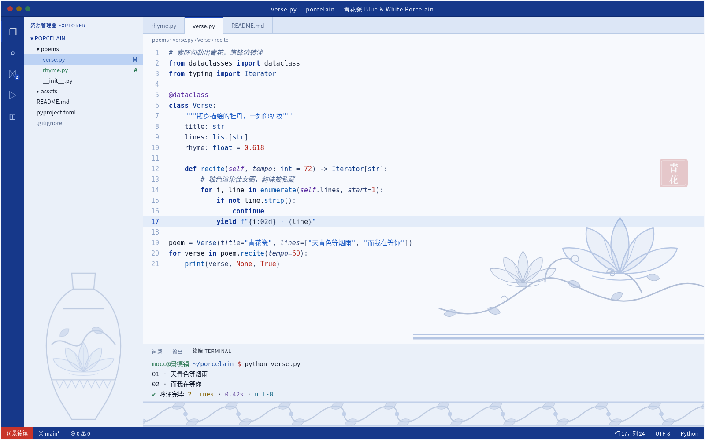

# 青花瓷 主题 + 装饰 安装说明（Windows / Cursor）

## 一、主题（v0.2.0，青花蓝更浓）
1. Cursor 扩展面板 → 右上角 `...` → **Install from VSIX...** → 选 `blue-white-porcelain-0.2.0.vsix`（会覆盖 0.1.0）。
2. 命令面板执行 **Preferences: Color Theme** → 选 **青花瓷 Blue & White Porcelain**。
   - 标题栏、活动栏、状态栏为钴蓝底白字。若标题栏仍是系统默认色，可在 settings.json 中加 `"window.titleBarStyle": "custom"`（VS Code 标准设置）。
3. 只装主题、不装装饰的配色见主题目录里的预览图：[preview.png](../themes/blue-white-porcelain/preview.png)。

## 二、装饰（依赖社区扩展 background，作者 shalldie）
本扩展通过**修改编辑器自身的 html 文件**来加背景图，非官方能力，请知悉。
1. 扩展面板搜索 `shalldie.background` 安装。
2. 新建文件夹 `C:\Users\<你的用户名>\cursor-bg\`，把 `images\` 里的 PNG 全部放进去。
3. 命令面板 → **Preferences: Open User Settings (JSON)**，把 `settings-porcelain.jsonc` 中的内容粘贴进最外层 `{ }`（注意逗号），把 `<you>` 改成你的用户名。路径用正斜杠 `C:/Users/...` 即可（官方文档示例支持 `C:/...`、`file:///...`、`https://` 和 `~`）。
4. 保存后按扩展提示重启 / Reload。效果见下图。

### 开关 / 卸载（来自扩展文档）
- 状态栏右下角点 **Background** 按钮，会列出该扩展的全部命令（安装/启用、禁用、卸载等）；也可在命令面板输入 `Background` 查找。
- 临时关闭：settings.json 设 `"background.enabled": false`。
- 卸载：推荐先点 Background 按钮选 **Uninstall the extension**；或先设 `enabled:false` 再卸载。直接卸载后需完全退出再打开、再 Reload 一次才干净。

### 注意
- **“安装似乎已损坏 / installation appears to be corrupt”提示**：扩展文档称 v2.0 起一般不会再出现；若出现，属修改 html 文件的副作用，可点“不再显示”，或按上面方法关闭/卸载即可恢复。
- **Cursor 更新后** html 文件会被重置，装饰可能消失：再点状态栏 Background 按钮重新启用（或执行一次 Reload）。
- 若提示只读/无写权限：文档建议右键以管理员身份运行一次后再启用。
- 当前 background 版本 3.1.0 要求 VS Code 引擎 ≥ 1.120；若 Cursor 的内核版本较旧导致无法安装，请告诉我，再找可用的旧版本。
- `useFront: true` 时图片浮在代码之上（已设 30% 透明度，且图案集中在右下角）；长代码行经过右下角时会看到淡淡的图案。想放到代码后面可改 `useFront: false`。

## 三、江南烟雨（附赠）
安装 `jiangnan-mist-0.1.0.vsix`，图片 `jiangnan-editor-corner.png`（白墙黛瓦 + 垂柳），配置见 `settings-jiangnan.jsonc`（两套配置二选一，不要同时粘贴相同的键）。
