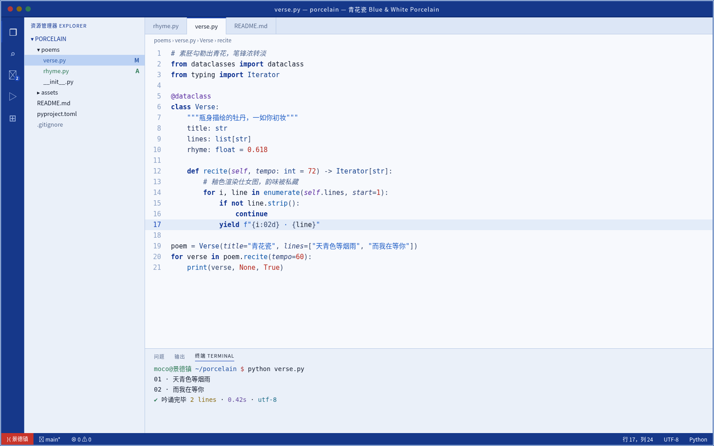

# 青花瓷 Blue & White Porcelain

青花瓷浅色主题：冷白瓷底、浓淡多层的青花蓝写代码，墨色正文，偶以釉里红点缀。主要文字对比度均达到 WCAG AA。

## 安装（Cursor / VS Code）

1. 打开扩展面板（Extensions）。
2. 点击面板右上角的 `...` 菜单，选择 **Install from VSIX...**。
3. 选择 `blue-white-porcelain-0.2.0.vsix` 文件。
4. 打开命令面板，执行 **Preferences: Color Theme**，选择 **青花瓷 Blue & White Porcelain**。

## 色板

| 用途 | 颜色 |
|---|---|
| 编辑器底色 | `#F7F9FD` |
| 侧栏 / 面板 | `#EAF0F9` |
| 正文 | `#141C2E` |
| 强调色 | `#1A47B8` |
| 关键字 | `#0B2F8F` |
| 字符串 | `#1C5BC4` |
| 函数 | `#0A54A8` |
| 类型 | `#123E8A` |
| 数字 / 常量 | `#B4261C` |
| 注释（斜体） | `#4F6690` |
| 状态栏 | `#16388A` |
