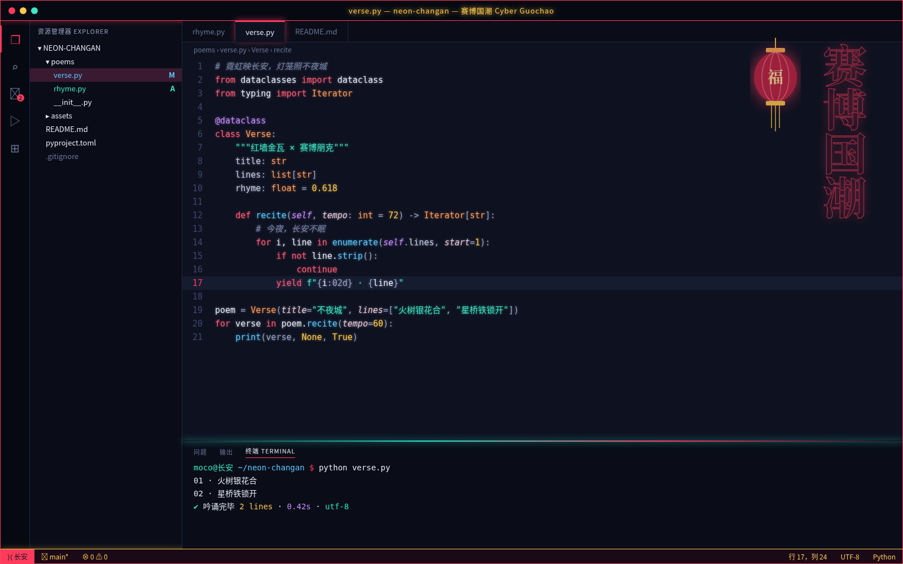

# 赛博国潮 Cyber Guochao

赛博国潮深色主题：近黑藏青底，霓虹中国红、霓虹金与青玉辉光，红灯笼与霓虹书法之感，亮而不刺眼。主要文字对比度均达到 WCAG AA。

## 安装（Cursor / VS Code）

1. 打开扩展面板（Extensions）。
2. 点击面板右上角的 `...` 菜单，选择 **Install from VSIX...**。
3. 选择 `cyber-guochao-0.1.0.vsix` 文件。
4. 打开命令面板，执行 **Preferences: Color Theme**，选择 **赛博国潮 Cyber Guochao**。

## 色板

| 用途 | 颜色 |
|---|---|
| 编辑器底色 | `#0E1220` |
| 侧栏 / 面板 | `#0A0D18` |
| 正文 | `#E4E8F4` |
| 强调色 | `#FF3B5C` |
| 关键字 | `#FF5C78` |
| 字符串 | `#3EE6C4` |
| 函数 | `#5CC8FF` |
| 类型 | `#FF9A5C` |
| 数字 / 常量 | `#FFC94D` |
| 注释（斜体） | `#7A84A8` |
| 状态栏 | `#1A0A18` |
