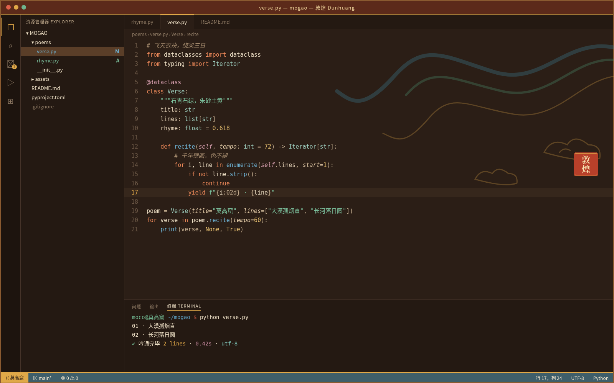

# 敦煌 Dunhuang

敦煌壁画风深色主题：赭褐土色底，石青、石绿、朱砂、土黄与金色交织，取莫高窟飞天之色。主要文字对比度均达到 WCAG AA。

## 安装（Cursor / VS Code）

1. 打开扩展面板（Extensions）。
2. 点击面板右上角的 `...` 菜单，选择 **Install from VSIX...**。
3. 选择 `dunhuang-0.1.0.vsix` 文件。
4. 打开命令面板，执行 **Preferences: Color Theme**，选择 **敦煌 Dunhuang**。

## 色板

| 用途 | 颜色 |
|---|---|
| 编辑器底色 | `#2B1E16` |
| 侧栏 / 面板 | `#241912` |
| 正文 | `#F0E2C8` |
| 强调色 | `#E0A848` |
| 关键字 | `#EF8A5A` |
| 字符串 | `#7DC4A0` |
| 函数 | `#6FB4D6` |
| 类型 | `#9FD0C0` |
| 数字 / 常量 | `#E8C070` |
| 注释（斜体） | `#A88E70` |
| 状态栏 | `#3E5E6A` |
