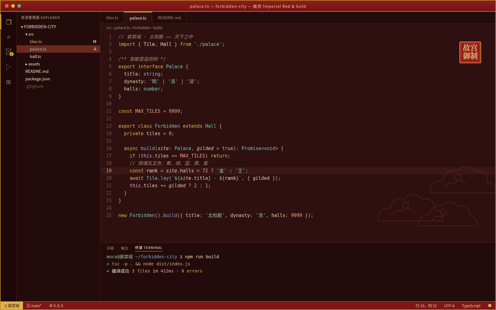

# 故宫 Imperial Red & Gold

故宫风深色配色主题：深宫墙红底色、象牙白正文、琉璃金关键字与强调色、玉绿字符串、石青函数、珊瑚朱数字、青铜斜体注释。主要文字对比度均达到 WCAG AA。

## 安装（Cursor / VS Code）

1. 打开扩展面板（Extensions）。
2. 点击面板右上角的 `...` 菜单，选择 **Install from VSIX...**。
3. 选择 `imperial-red-gold-0.1.0.vsix` 文件。
4. 打开命令面板，执行 **Preferences: Color Theme**，选择 **故宫 Imperial Red & Gold**。

## 色板

| 用途 | 颜色 |
|---|---|
| 编辑器底色 | `#2E1010` |
| 侧栏 / 活动栏 | `#240B0B` / `#1C0808` |
| 标题栏 / 状态栏（宫墙红） | `#7E1616`，金字 `#F3D58A` |
| 正文（象牙白） | `#F3E6C8` |
| 关键字 / 强调（琉璃金） | `#E8B547` / `#E0B04A` |
| 字符串（玉绿） | `#8CC7A1` |
| 函数（石青） | `#7FB2E0` |
| 类型（石绿） | `#7CC4BC` |
| 数字 / 常量（珊瑚朱） | `#F2A285` |
| 注释（青铜） | `#A88B6A` 斜体 |
