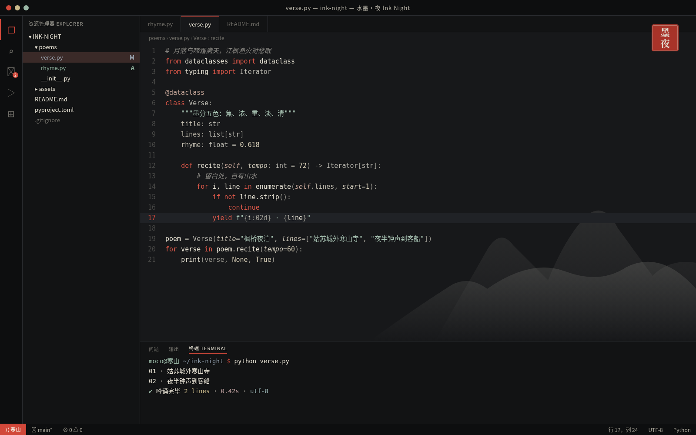

# 水墨·夜 Ink Night

水墨夜色深色主题：墨黑底、墨分五色的层层灰阶、象牙白正文，仅以一枚朱砂印红作关键字点睛，玉白与银灰写字符串。主要文字对比度均达到 WCAG AA。

## 安装（Cursor / VS Code）

1. 打开扩展面板（Extensions）。
2. 点击面板右上角的 `...` 菜单，选择 **Install from VSIX...**。
3. 选择 `ink-night-0.1.0.vsix` 文件。
4. 打开命令面板，执行 **Preferences: Color Theme**，选择 **水墨·夜 Ink Night**。

## 色板

| 用途 | 颜色 |
|---|---|
| 编辑器底色 | `#17181A` |
| 侧栏 / 面板 | `#121314` |
| 正文 | `#E6E1D3` |
| 强调色 | `#D2483A` |
| 关键字 | `#E0594A` |
| 字符串 | `#A9C4B4` |
| 函数 | `#E6E1D3` |
| 类型 | `#B8B6AE` |
| 数字 / 常量 | `#D8CFB8` |
| 注释（斜体） | `#878580` |
| 状态栏 | `#0D0E0F` |
