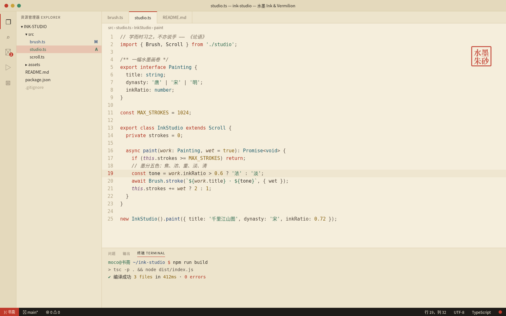

# 水墨 Ink & Vermilion

中国风浅色配色主题：宣纸暖白底色、墨色正文、朱红关键字、玉绿字符串、赭金数字常量、黛蓝函数与类型、灰褐斜体注释。主要文字对比度均达到 WCAG AA。

## 安装（Cursor / VS Code）

1. 打开扩展面板（Extensions）。
2. 点击面板右上角的 `...` 菜单，选择 **Install from VSIX...**。
3. 选择 `ink-vermilion-0.1.0.vsix` 文件。
4. 打开命令面板，执行 **Preferences: Color Theme**，选择 **水墨 Ink & Vermilion**。

## 色板

| 用途 | 颜色 |
|---|---|
| 编辑器底色（宣纸） | `#F5EEDC` |
| 侧栏 / 面板 | `#EDE4CC` / `#E4D9BC` |
| 正文（墨） | `#2B2622` |
| 关键字（朱红） | `#B0301F`，强调 `#C0392B` |
| 字符串（玉绿） | `#2E6B4F` |
| 数字 / 常量（赭金） | `#86600F` |
| 函数（黛蓝） | `#2F4A78` |
| 类型 / 类 | `#1F5C6B` |
| 注释 | `#76695A` 斜体 |
| 状态栏 | `#1E1B18` 底、`#F5EEDC` 字 |
