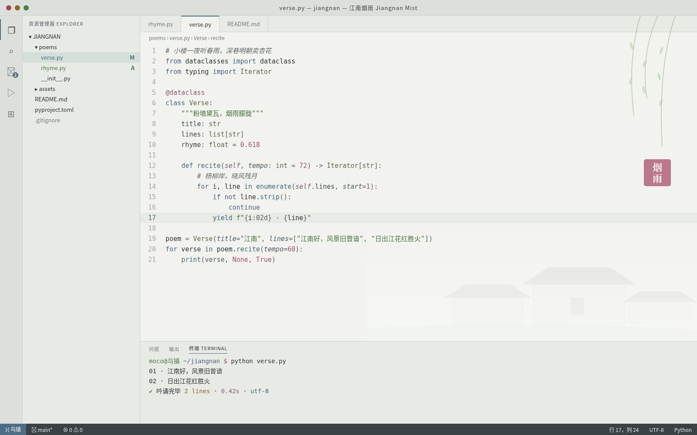

# 江南烟雨 Jiangnan Mist

江南烟雨浅色主题：粉墙黛瓦、烟灰青绿、柳绿、荷粉与黛蓝，低饱和而清晰可读。主要文字对比度均达到 WCAG AA。

## 安装（Cursor / VS Code）

1. 打开扩展面板（Extensions）。
2. 点击面板右上角的 `...` 菜单，选择 **Install from VSIX...**。
3. 选择 `jiangnan-mist-0.1.0.vsix` 文件。
4. 打开命令面板，执行 **Preferences: Color Theme**，选择 **江南烟雨 Jiangnan Mist**。

## 色板

| 用途 | 颜色 |
|---|---|
| 编辑器底色 | `#F2F3EF` |
| 侧栏 / 面板 | `#E8EAE5` |
| 正文 | `#2C3236` |
| 强调色 | `#4E6E86` |
| 关键字 | `#4E6382` |
| 字符串 | `#46703F` |
| 函数 | `#3E6A7A` |
| 类型 | `#5E6A4A` |
| 数字 / 常量 | `#A8506A` |
| 注释（斜体） | `#646D67` |
| 状态栏 | `#3A4246` |
